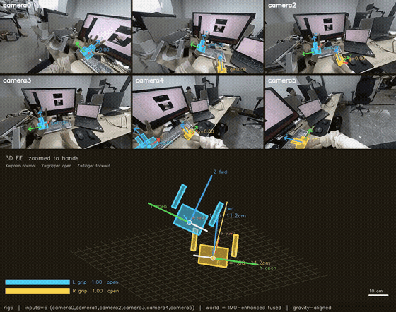
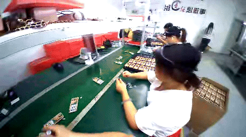
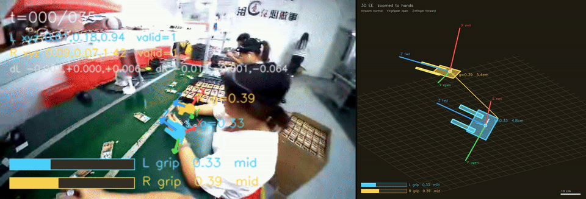
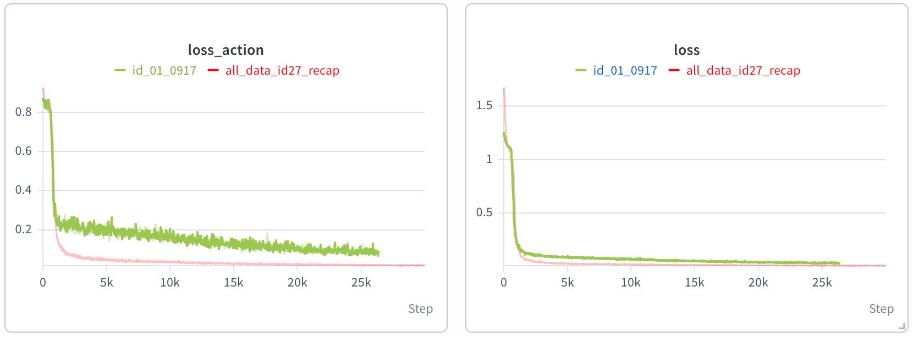
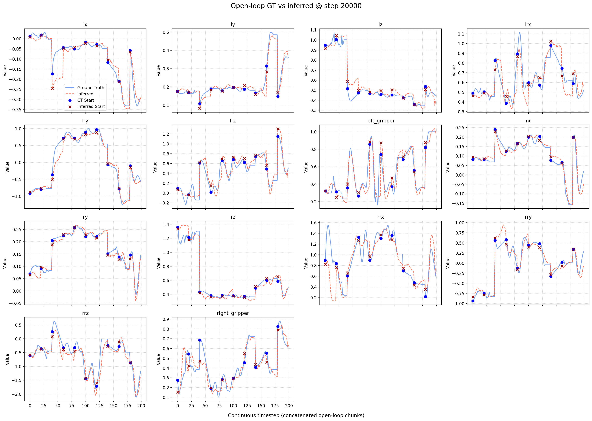
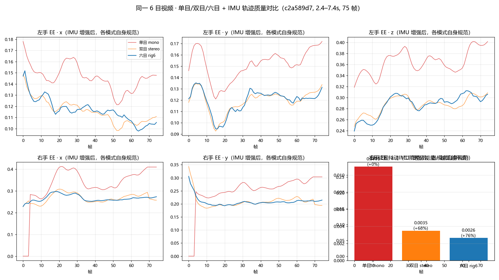
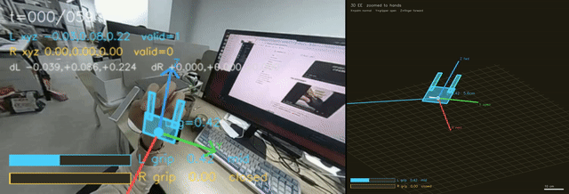

# EgoVLA

把第一人称视频变成 VLA 训练数据：**世界坐标系双手末端 14-DoF state/action**，
`lerobot_v3` / Pi0.5 格式。一条管道，两类输入：

**自采数据（主线）**——ros bag（mcap）多目鱼眼 + IMU 头戴录制，从数据采集到训练数据集全链打通：

> mcap 解包与**视频/IMU 时间对齐**（共同 log 时钟）→ 鱼眼去畸变 → **YOLO 手部过滤** →
> **GeoCalib** 相机估计 → **MoGe** 深度 + **HaWoR** 手部建模 → **MegaSaM** SLAM →
> 多目融合（Umeyama 跨目配准 + 立体三角化度量尺度）→ IMU 增强（重力对齐 + 陀螺去抖）→
> 世界系 14DoF 轨迹清理 → `lerobot_v3` → **Pi0.5 14 维格式**

**公共数据集**（Egocentric-100K 等 ego 视频）：

> 规格化 → YOLO 手部过滤 → GeoCalib → MoGe + HaWoR → MegaSaM → 世界系转换与轨迹清理 → `lerobot_v3` → Pi0.5 14 维格式

自采数据示例**克隆即得**（见 [`examples/`](examples/)）：EgoCap（LYZ）双目录制转换件
[`examples/egocap_das_export/`](examples/egocap_das_export/)、DAS-Ego 六目三模式对比
[`examples/das_compare/`](examples/das_compare/)、端到端产出的 Pi0.5 episode
[`examples/das_pi05_preview/`](examples/das_pi05_preview/)；
公共数据集示例为 [`examples/egovideo/`](examples/egovideo/) 的 3 条视频（下面的命令用它做演示）。

## 做什么

把 ego 视频转成**世界坐标系双手末端 14DoF 轨迹**，用来训练 VLA，再看开环测试。

<p align="center">
  
  <br>
  <em>自采数据（DAS-Ego 六目鱼眼 + IMU）：六路输入面板叠加手部建模，下方为 IMU 增强的世界系双手 3D 轨迹</em>
</p>

<p align="center">
  
  
  <br>
  <em>公共数据集示例（Egocentric-100K）：左：原始 ego 视频 → 右：世界系双手末端 14DoF 轨迹</em>
</p>

<p align="center">
  
  <br>
  <em>训练 loss。红：ego delta EE；绿：示教 delta joint</em>
</p>

<p align="center">
  
  <br>
  <em>ego 数据训练后的开环测试（GT vs inferred）</em>
</p>

原视频见 [`docs/assets/ego_source.mp4`](docs/assets/ego_source.mp4)、[`docs/assets/world_14dof.mp4`](docs/assets/world_14dof.mp4)。

## 环境

新机器先装 Conda 环境并注册第三方后端：

```bash
bash scripts/create_env.sh
conda activate ego2lerobot
bash scripts/install_data_backends.sh
python -m cli doctor --profile data --strict
```

仓库根目录已有 `.venv` 时，直接激活即可：

```bash
source .venv/bin/activate   # 或直接用 .venv/bin/python

export TORCH_FORCE_NO_WEIGHTS_ONLY_LOAD=1
export EGO2LEROBOT_RAY_TMP=$HOME/ego2lerobot_cache/ray
export TORCH_HOME=$HOME/ego2lerobot_cache/torch
export TRITON_CACHE_DIR=$HOME/ego2lerobot_cache/triton
export EGO2LEROBOT_GPU_ALLOC_GB=120
export RAY_local_fs_capacity_threshold=0.99
export PYTHONUNBUFFERED=1

python -m cli doctor --profile data --strict
```

权重不随仓库分发，放到 `model/` 后可用 `python -m cli doctor --profile data --strict` 检查。HaWoR 源码放到 `third_party/HaWoR/`。**MANO 手模型文件不随仓库分发**：需在 [MANO 官网](https://mano.is.tue.mpg.de/) 注册并接受其许可后自行下载，放置方式见 [`docs/installation.md`](docs/installation.md)。细节见 [`docs/installation.md`](docs/installation.md)。

| 权重 | 本地路径 | 下载 |
| --- | --- | --- |
| GeoCalib pinhole | `model/geocalib/pinhole.tar` | [GitHub Release](https://github.com/cvg/GeoCalib/releases/download/v1.0/geocalib-pinhole.tar) |
| MoGe-2 ViT-L + normal | `model/moge2/model.pt` | [Hugging Face](https://huggingface.co/Ruicheng/moge-2-vitl-normal/resolve/main/model.pt) |
| MegaSaM | `model/megasam/megasam_final.pth` | [Hugging Face](https://huggingface.co/datasets/UCBProject/Affordance2Grasp-Weights/resolve/main/MegaSAM/checkpoints/megasam_final.pth) |
| HaWoR | `model/hawor/hawor.ckpt` | [Hugging Face](https://huggingface.co/ThunderVVV/HaWoR/resolve/main/hawor/checkpoints/hawor.ckpt) |
| HaWoR config | `model/hawor/model_config.yaml` | [Hugging Face](https://huggingface.co/ThunderVVV/HaWoR/resolve/main/hawor/model_config.yaml) |
| HaWoR 手部检测器 | `model/hawor/detector.pt` | [Hugging Face](https://huggingface.co/spaces/rolpotamias/WiLoR/resolve/main/pretrained_models/detector.pt) |

```bash
mkdir -p model/geocalib model/moge2 model/megasam model/hawor

wget -O model/geocalib/pinhole.tar \
  https://github.com/cvg/GeoCalib/releases/download/v1.0/geocalib-pinhole.tar

wget -O model/moge2/model.pt \
  https://huggingface.co/Ruicheng/moge-2-vitl-normal/resolve/main/model.pt

wget -O model/megasam/megasam_final.pth \
  https://huggingface.co/datasets/UCBProject/Affordance2Grasp-Weights/resolve/main/MegaSAM/checkpoints/megasam_final.pth

wget -O model/hawor/hawor.ckpt \
  https://huggingface.co/ThunderVVV/HaWoR/resolve/main/hawor/checkpoints/hawor.ckpt
wget -O model/hawor/model_config.yaml \
  https://huggingface.co/ThunderVVV/HaWoR/resolve/main/hawor/model_config.yaml
wget -O model/hawor/detector.pt \
  https://huggingface.co/spaces/rolpotamias/WiLoR/resolve/main/pretrained_models/detector.pt
```

## DAS 可视化界面

DAS-Ego 多目录制（mcap）无需记命令行参数，用本地 Web 界面完成全流程：

```bash
python ego_pipeline/preprocessing/das/app.py
# 浏览器打开 http://localhost:7861
```

选录制 → 选模式（单目 / 双目 / 六目）→ 设窗口起点/时长 → 运行：实时日志，
完成后页面内直接播放 `multiview.mp4`，每次结果独立目录不覆盖。支持粘贴
Windows 路径一键导入 EgoCap mcap（自动转换为 DAS 兼容目录后即可选运行）。
数据源自动扫描通过环境变量 `EGO2LEROBOT_MCAP_GLOBS` 配置（分号分隔 glob）。
界面底层调用的仍是 `run_multiview.py`，与命令行完全等价；命令行用法与
三模式对比见 [`ego_pipeline/preprocessing/das/README.md`](ego_pipeline/preprocessing/das/README.md)。

## 自采数据：DAS-Ego 六目 → Pi0.5

同一条链路直接处理自采的 DAS-Ego 六目鱼眼 + IMU 录制（mcap）。单目 / 双目 / 六目
同一窗口实测对比：

<p align="center">
  
  <br>
  <em>三模式同窗对比（c2a589d7 录制，2.4–7.4s）：多目融合显著降低轨迹抖动</em>
</p>

| 模式 | EE 位置抖动 | 相对单目 |
| --- | --- | --- |
| mono | 0.01096 | — |
| stereo | 0.00349 | −68% |
| rig6 | 0.00265 | −76% |

自采数据最终转换出的 Pi0.5 训练 episode（世界系 14DoF state/action + 视频）：

<p align="center">
  
  <br>
  <em>自采 DAS-Ego 录制 → lerobot_v3 → Pi0.5 格式 episode 可视化</em>
</p>

原视频见 [`rig6_multiview.mp4`](docs/assets/das/rig6_multiview.mp4)、[`pi05_episode.mp4`](docs/assets/das/pi05_episode.mp4)；
三模式完整对比数据（跨目配准残差、尺度收敛等）见 `ego_pipeline/preprocessing/das/README.md`。

以上自采数据的示例产物**随仓库分发，克隆即得**：

| 目录 | 内容 |
| --- | --- |
| [`examples/das_compare/`](examples/das_compare/) | mono / stereo / rig6 三模式同窗对比完整产物：各模式 `multiview.mp4`、指标 `metrics.npz`、帧快照、融合 `stereo_fused.parquet` |
| [`examples/das_pi05_preview/`](examples/das_pi05_preview/) | 自采录制端到端产出的一个完整 Pi0.5 训练 episode（lerobot_v3 格式）：`data/` state/action parquet、`meta/` 元数据、`videos/` 观测视频 |

原始 mcap 录制与更大规模的数据集不随 git 分发。

## 预处理

规格化 15 fps、不超过 456×256、60s 切段，再切掉没手、超过两只手、同侧重复的帧。

```bash
#规格化：30fps、不超过 456×256、60s 切段（原文生产参数）
python ego_pipeline/preprocessing/reprocessed/main.py \
  --ops fps+resolution+segment \
  --input  examples/egovideo \
  --output_dir examples/reprocessed \
  --max_fps 15 \
  --max_width 456 --max_height 256 \
  --scale_mode resize \
  --duration 60 \
  --codec h264 --crf 18 --preset ultrafast \
  --workers 16 \
  --overwrite \
  --verify

#YOLO 手部过滤：切掉没手、超过两只手、同侧重复
python ego_pipeline/preprocessing/filtered/main.py \
  --ops hand_filter \
  --input  examples/reprocessed \
  --output_dir examples/filtered \
  --filter_multi_hands --require_lr_pair \
  --gpus 6,7 \
  --overwrite

#校验段区间不重叠、元数据完整
python ego_pipeline/preprocessing/filtered/verify.py \
  --input  examples/reprocessed \
  --output examples/filtered
```

## 重建管线

```bash
EGO2LEROBOT_GPU_ALLOC_GB=120 \
python -m cli pipeline \
  --input  examples/filtered \
  --output examples/pipeline \
  --num_gpus 8 \
  --test \
  --long_video_threshold_s 1000000 \
  --per_video_lerobot \
  --aggregate_lerobot \
  --delete_temp yes
```

中断后续跑：

```bash
EGO2LEROBOT_GPU_ALLOC_GB=120 \
python -m cli pipeline \
  --input  examples/filtered \
  --resume examples/pipeline \
  --num_gpus 8 \
  --test \
  --long_video_threshold_s 1000000 \
  --retry_failed
```

## 转成 Pi0.5 14 维

`--action-mode absolute` 存绝对值 EE；去掉该参数则是 delta EE。

```bash
python ego_pipeline/tasks/lerobot_to_pi05.py \
  --source examples/pipeline \
  --output examples/lerobot_pi05 \
  --action-mode absolute \
  --prompt "assemble electronic products" \
  --overwrite
```

中断后续跑：

```bash
python ego_pipeline/tasks/lerobot_to_pi05.py \
  --source examples/pipeline \
  --output examples/lerobot_pi05 \
  --resume
```

## 3D 可视化

`--source-v3` 指向管线为该 episode 写出的 `lerobot_v3` 目录；跑完上面的管线后按实际路径替换。

```bash
python ego_pipeline/tasks/visualize_pi05_ee.py \
  --dataset examples/lerobot_pi05 \
  --source-v3 examples/pipeline \
  --output examples/lerobot_pi05/viz_episode_000000.mp4
```
